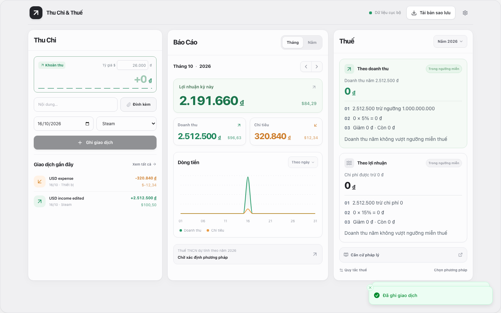
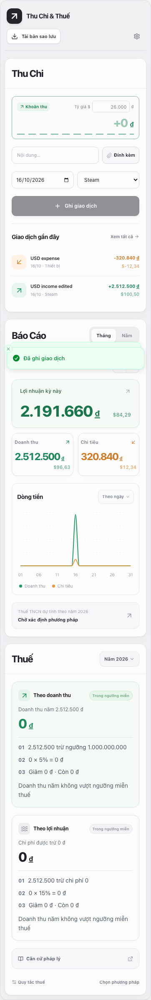

# Thu Chi & Thuế

Ứng dụng tài chính cá nhân chạy cục bộ: quản lý thu chi, báo cáo và so sánh phương pháp thuế. Giao diện React, TypeScript, shadcn/ui, Tailwind và Recharts được nhúng vào một Go executable dùng SQLite. Bản đã build không cần Node.js hay Internet.

## Giao diện web



<details>
<summary>Xem giao diện điện thoại</summary>



</details>

## Chạy ứng dụng

```sh
./bin/thuchithue
```

Mở http://127.0.0.1:3210. Mặc định ứng dụng chạy im lặng và không tự mở trình duyệt. Giữ terminal mở khi sử dụng; nhấn Ctrl+C để đóng an toàn.

```sh
./bin/thuchithue --port 9090
./bin/thuchithue --headless=false --quiet=false
./bin/thuchithue --data-dir /duong/dan/du/lieu
```

`--port` đổi cổng, `--headless=false` mở trình duyệt và `--quiet=false` hiện địa chỉ máy chủ. Có thể dùng `--listen` cho địa chỉ tùy chỉnh, nhưng không kết hợp với `--port`. Mặc định máy chủ lắng nghe trên `0.0.0.0` để truy cập từ mạng riêng.

Dùng script để chạy im lặng ở nền, giữ máy chủ hoạt động sau khi đóng terminal:

```sh
./run_server.sh --hup
./run_server.sh --kill
./run_server.sh --kill --hup --port 3210
```

`--kill` dừng ứng dụng tại cổng đã chọn; kết hợp `--hup` để khởi động lại ở nền. Không có tùy chọn, script chạy ở foreground. Log được lưu trong `.tmp/server.PORT.log` khi chạy nền.

Trên macOS, dữ liệu nằm tại `~/Library/Application Support/ThuChiThue/finance.db`; hệ điều hành khác dùng thư mục cấu hình người dùng. Binary hiện tại được build cho macOS Apple Silicon.

## Mật khẩu và passkey

Lần chạy đầu tự tạo `config.local.json` với mật khẩu ngẫu nhiên. Xem hoặc đổi `access_password` trong tệp này, rồi khởi động lại máy chủ. Tệp cấu hình riêng được Git bỏ qua; [config.example.json](config.example.json) là mẫu có thể chia sẻ. Dùng `--config` với binary hoặc script để chọn tệp khác.

Mọi thiết bị, kể cả máy chủ, cần mở khóa bằng mật khẩu hoặc passkey trước khi đọc dữ liệu. Phiên mở khóa mặc định kéo dài 720 giờ, được điều chỉnh bằng `session_hours`; khởi động lại máy chủ hoặc chọn “Khóa ứng dụng” sẽ kết thúc phiên tương ứng. Không giới hạn số lần thử mật khẩu và không khóa tài khoản theo địa chỉ mạng.

Để dùng passkey trên điện thoại, bật HTTPS trong Tailscale Serve và cấu hình đúng tên miền:

```json
{
  "listen": "127.0.0.1:3210",
  "access_password": "mat khau cua ban",
  "session_hours": 720,
  "passkey_rp_id": "vits-mac-mini.taila2e14b.ts.net",
  "passkey_origins": ["https://vits-mac-mini.taila2e14b.ts.net"]
}
```

```sh
tailscale serve --bg --https=443 http://127.0.0.1:3210
```

Khi Tailscale Serve đã giữ cổng 3210 trên mạng, đặt `listen` thành `127.0.0.1:3210` như trên để truy cập qua proxy. Nếu truy cập LAN trực tiếp, dùng `0.0.0.0:3210`.

Mở địa chỉ HTTPS, nhập mật khẩu rồi vào Cài đặt → Thêm passkey. Những lần sau chọn “Đăng nhập bằng passkey”. HTTP vẫn hỗ trợ mật khẩu; passkey cần HTTPS hoặc `localhost`, và gắn với tên miền đã đăng ký. `passkey_origins` cần chứa địa chỉ đầy đủ, gồm cổng nếu có.

Passkey được lưu riêng tại `passkeys.json` trong thư mục dữ liệu, không nằm trong bản sao lưu SQLite. Mật khẩu trong tệp cấu hình luôn có thể dùng để mở khóa khi không còn passkey.

## Giao diện và sao lưu Google Drive

Nút mặt trăng hoặc mặt trời cạnh Cài đặt chuyển giao diện sáng tối và nhớ lựa chọn trên trình duyệt.

Trong Cài đặt → Google Drive, nhập tệp OAuth client của Google Cloud rồi kết nối tài khoản để sao lưu SQLite. Ứng dụng chỉ tải lên khi bạn bấm sao lưu, kiểm tra tính toàn vẹn và hiển thị liên kết tệp gần nhất. Xem [hướng dẫn thiết lập Google Drive](docs/google-drive.md).

## Chức năng chính

1. Ghi, sửa, tìm, lọc và xóa mềm giao dịch theo ngày, danh mục, loại và ghi chú. Quản lý danh mục, đính kèm tối đa 5 chứng từ PDF, JPG hoặc PNG, mỗi tệp tối đa 10 MB.
2. Báo cáo tháng và năm với doanh thu, chi tiêu, lợi nhuận, thuế và biểu đồ lũy kế. Tiền được lưu và tính bằng số nguyên VND.
3. Nhập USD với tỷ giá thủ công tại ô “Tỷ giá $”, ví dụ `$100` hoặc `100$`. Giao dịch giữ USD gốc và tỷ giá lúc lưu; đổi tỷ giá chung không thay đổi giao dịch cũ.
4. So sánh phương pháp thuế, đánh dấu chi phí đủ điều kiện và chia lợi nhuận sau thuế theo tỷ lệ mặc định 70% và 30%. Quy tắc có phiên bản, nguồn tham chiếu và lịch sử thay đổi; báo cáo đã chốt giữ snapshot của cơ sở tính và kết quả.
5. Sao lưu SQLite gồm giao dịch, chứng từ, quy tắc và lịch sử. Khôi phục tệp tối đa 50 MB sau khi kiểm tra tính toàn vẹn; tự sao lưu dữ liệu hiện tại trước khi thay thế.

Ứng dụng bắt đầu với giao dịch trống. “Khám phá với dữ liệu mẫu” nạp bốn giao dịch minh họa; dùng thư mục riêng qua `--data-dir` để tách dữ liệu mẫu và dữ liệu thật.

“Xóa toàn bộ dữ liệu” trong Cài đặt yêu cầu mật khẩu xác nhận, xóa vĩnh viễn dữ liệu người dùng và bản sao lưu tự động. Các bản sao lưu đã tải về ngoài thư mục quản lý được giữ lại.

## Phạm vi thuế

Quy tắc khởi tạo cho 2026 và 2027 lấy từ GDD v2.2 và nguồn tham chiếu, được đánh dấu tham khảo. Giao diện nhắc khi nguồn chưa xác minh hoặc quá 180 ngày; năm khác cần quy tắc riêng.

Báo cáo dùng tiền thực nhận, không tự đồng nhất Steam gross, payout và doanh thu tính thuế. Người dùng cần đối chiếu phân loại kinh doanh, cư trú, chứng từ và văn bản áp dụng trước khi xác nhận cơ sở tính và chốt báo cáo. Chưa có bộ tính thuế GTGT. Phép tính làm tròn đến đồng gần nhất, đúng nửa đồng thì ra xa số 0.

Chưa hỗ trợ giao diện import CSV, ngoại tệ ngoài USD và so sánh nhiều năm.

## Phát triển

Cần Node.js 22.12 trở lên và Go 1.25 trở lên. SQLite driver thuần Go không cần CGO.

```sh
npm ci
npm run release
npm start
```

Để sửa giao diện, chạy `npm start` và `npm run dev` trong hai terminal. Vite tại http://127.0.0.1:5173 chuyển `/api` tới Go ở cổng 3210. Chạy lại `npm run release` sau khi sửa UI để nhúng giao diện mới vào binary.

## Kiểm thử

```sh
npm test
go test ./...
npm run release
npx playwright install chromium
npm run test:e2e
```

Các bộ kiểm thử bao phủ nhập tiền, giao dịch, chứng từ, danh mục, quy tắc thuế, sao lưu, khôi phục, bảo vệ yêu cầu và bố cục trên máy tính lẫn điện thoại. Playwright tự chạy binary ở cổng 8081 với dữ liệu tạm riêng, rồi dọn dữ liệu khi kết thúc.

Các component giao diện từ shadcn/ui có giấy phép tại [LICENSE.shadcn](web/src/components/ui/LICENSE.shadcn).
